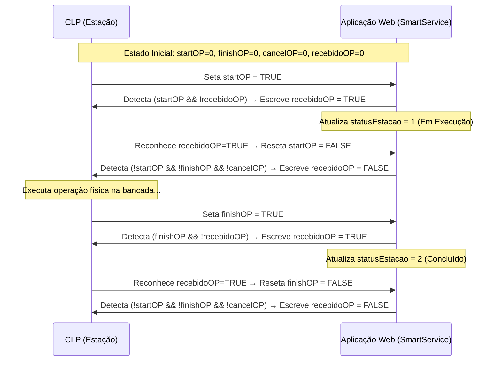

# Especificação do Protocolo S7 e Mapa de Memória dos CLPs

> **ATENÇÃO AGENTES DE IA:** Este documento descreve o contrato físico e binário com os 4 CLPs Siemens (S7-1200/S7-1500) e o ESP32 da Bancada Smart. **Estes offsets, tamanhos de Data Blocks e regras de handshake refletem a programação Ladder gravada nos CLPs e NÃO PODEM SER ALTERADOS.**

---

## 1. Topologia de Rede Industrial

| Dispositivo | Nome Interno | IP Padrão | Porta | Protocolo | DB Principal | Tamanho Leitura | Intervalo Polling |
|---|---|---|---|---|---|---|---|
| **CLP 1 — Estoque** | `estoque` | `10.74.241.10` | `102` | S7 Comm (ISO-on-TCP) | `DB9` | `111 bytes` (offset `0`) | `800 ms` |
| **CLP 2 — Processo** | `processo` | `10.74.241.20` | `102` | S7 Comm (ISO-on-TCP) | `DB2` | `9 bytes` (offset `0`) | `800 ms` |
| **CLP 3 — Montagem** | `montagem` | `10.74.241.30` | `102` | S7 Comm (ISO-on-TCP) | `DB57` | `9 bytes` (offset `0`) | `800 ms` |
| **CLP 4 — Expedição** | `expedicao` | `10.74.241.40` | `102` | S7 Comm (ISO-on-TCP) | `DB9` | `48 bytes` (offset `0`) | `800 ms` |
| **ESP32 — Tampa** | — | `10.74.241.245` | `80` | HTTP REST | — | Sob demanda | — |

- A faixa de rede padrão é `10.74.241.X`, podendo ser alterada na interface web para `<faixa>.10`, `<faixa>.20`, `<faixa>.30` e `<faixa>.40`.
- Todas as palavras de 16 bits (`INT` / `WORD`) e 32 bits (`REAL` / `FLOAT`) no protocolo S7 utilizam ordem **Big-Endian** (`ByteOrder.BIG_ENDIAN`).

---

## 2. Estrutura do Protocolo S7 (`S7Client.java`)

A comunicação S7 sobre TCP (RFC 1006 / ISO-on-TCP, porta `102`) ocorre em 3 fases na abertura da conexão:

### 2.1. Handshake de Conexão
1. **Abertura de Socket TCP** em `<ip>:102`.
2. **COTP Connection Request (22 bytes):**
   ```text
   TPKT (4B): 03 00 00 16
   COTP (18B): 11 E0 00 00 00 01 00 C1 02 01 00 C2 02 01 01 C0 01 09
   ```
   - Aguarda resposta COTP Connection Confirm (`inputStream.read`).
3. **S7 Setup Communication (25 bytes):**
   ```text
   TPKT (4B): 03 00 00 19
   COTP (3B): 02 F0 80
   S7 Header (10B): 32 01 00 00 00 00 00 08 00 00
   S7 Params (8B): F0 00 00 01 00 01 03 C0 (PDU size = 960 bytes)
   ```
   - Aguarda confirmação de negociação PDU (`inputStream.read`).

### 2.2. Pacote de Leitura (`createReadRequest` — 31 bytes)
- **Function Code:** `0x04` (Read Var), `Item Count = 0x01`.
- **Area Type:** `0x84` (Data Block - DB).
- **Transport Size (`tpSize`) e Endereço de Início (`startAddress`):**
  - Para `boolean` (`size == 1`): `tpSize = 0x01` (BIT), `startAddress = ((offset << 3) & 0xFFF8) | (bit & 0x07)`.
  - Para demais tipos (`byte`, `integer`, `float`, `string`, `block`): `tpSize = 0x02` (BYTE), `startAddress = offset << 3` (endereço em bits).
- **Extração dos Dados da Resposta de Leitura:**
  - O payload de dados na resposta S7 começa sempre no **índice de byte `25`** (`response[25]`).
  - `boolean`: `(response[25] & 0x01) == 1`
  - `byte`: `response[25]`
  - `integer` (16-bit signed short): `ByteBuffer.wrap(response, 25, 2).order(BIG_ENDIAN).getShort()`
  - `float` (32-bit IEEE 754): `ByteBuffer.wrap(response, 25, 4).order(BIG_ENDIAN).getFloat()`
  - `block` (`size` bytes): `Arrays.copyOfRange(response, 25, 25 + size)`

### 2.3. Pacote de Escrita (`createWriteRequest` — `35 + lengthTag` bytes)
- **Function Code:** `0x05` (Write Var), `Item Count = 0x01`.
- **Transport Size no Data Item (`buffer.put((byte) (tpSize + 2))`):**
  - Para `boolean`: `tpSize = 0x01` → Data Transport Size = `0x03` (BIT), Length = `1`, valor = `0x01` (`true`) ou `0x00` (`false`).
  - Para `byte`, `integer`, `block`, `float`, `string`: `tpSize = 0x02` → Data Transport Size = `0x04` (BYTE), Length em bits = `lengthTag << 3`.
- **Confirmação de Escrita:**
  - O CLP responde com um pacote onde `response[21] == (byte) 0xFF` indica sucesso (`0xFF` = Return Code Success).

---

## 3. Mapa Detalhado de Memória por Estação

### 3.1. Estação 1 — ESTOQUE (`10.74.241.10`, `DB9`, `111 bytes`)

#### Direção: Aplicação Web → CLP (`NodeToPlc`)
| Endereço S7 | Offset Byte | Bit | Tipo | Nome da Variável | Descrição |
|---|---|---|---|---|---|
| `DB9.DBX0.0` | `0` | `0` | `BOOL` | `recebidoOpEst` | Handshake: confirma recebimento de `startOPEst` ou `finishOPEst` |
| `DB9.DBB2..61` | `2..61` | — | `BYTE[60]` | `InformacaoPedido` | Bloco de 60 bytes (30 `INT` 16-bit) com os dados completos do pedido (ver Seção 4) |
| `DB9.DBX62.0` | `62` | `0` | `BOOL` | `iniciarPedido` | Pulso de comando para iniciar a execução do pedido no CLP Estoque |
| `DB9.DBX64.0` | `64` | `0` | `BOOL` | `recebidoEstoque` | Handshake: confirma processamento de `adicionarEstoque` ou `removerEstoque` |
| `DB9.DBX64.1` | `64` | `1` | `BOOL` | `iniciarGuardarEst` | Comando para o CLP guardar peça na posição `posicaoGuardarEst` |
| `DB9.DBW66` | `66..67` | — | `INT` | `posicaoGuardarEst` | Posição livre (`1..28`) enviada ao CLP quando `pedirPosicaoEst == true` |
| `DB9.DBB68..95` | `68..95` | — | `BYTE[28]` | `posicoesOcupadas` | Mapa das 28 posições do magazine (`offset = 68 + pos - 1`). Valores: `0`=Livre, `1`=Preto, `2`=Vermelho, `3`=Azul |

#### Direção: CLP → Aplicação Web (`PlcToNode`)
| Endereço S7 | Offset Byte | Bit | Tipo | Nome da Variável | Descrição |
|---|---|---|---|---|---|
| `DB9.DBW96` | `96..97` | — | `INT` | `numeroOPEst` | Número da Ordem de Produção atual no Estoque |
| `DB9.DBX98.0` | `98` | `0` | `BOOL` | `cancelOPEst` | Operação cancelada no Estoque |
| `DB9.DBX98.1` | `98` | `1` | `BOOL` | `finishOPEst` | Operação finalizada no Estoque |
| `DB9.DBX98.2` | `98` | `2` | `BOOL` | `startOPEst` | Operação iniciada no Estoque |
| `DB9.DBX100.0` | `100` | `0` | `BOOL` | `ocupadoEst` | Estação Estoque está ocupada executando movimento |
| `DB9.DBX100.1` | `100` | `1` | `BOOL` | `aguardandoEst` | Estação Estoque em espera |
| `DB9.DBX100.2` | `100` | `2` | `BOOL` | `manualEst` | Chave seletora em modo Manual |
| `DB9.DBX100.3` | `100` | `3` | `BOOL` | `emergenciaEst` | Botão de emergência acionado |
| `DB9.DBX102.0` | `102` | `0` | `BOOL` | `pedirPosicaoEst` | CLP solicita à aplicação uma posição livre para guardar bloco |
| `DB9.DBW104` | `104..105` | — | `INT` | `posicaoEstoque` | Posição (`1..28`) sendo adicionada ou removida pelo CLP |
| `DB9.DBX106.0` | `106` | `0` | `BOOL` | `adicionarEstoque` | CLP informa que adicionou bloco de cor `corGuardarEstoque` em `posicaoEstoque` |
| `DB9.DBX106.1` | `106` | `1` | `BOOL` | `removerEstoque` | CLP informa que removeu bloco da posição `posicaoEstoque` |
| `DB9.DBX106.2` | `106` | `2` | `BOOL` | `retornoEstoqueCheio` | CLP informa que o estoque está cheio |
| `DB9.DBW108` | `108..109` | — | `INT` | `corGuardarEstoque` | Cor (`1..3`) do bloco que está sendo guardado em `posicaoEstoque` |
| `DB9.DBB110` | `110` | `0..6` | `BOOL` | `RealidadeAumentada` | Bits `xEmergenciaAtivadaEst`, `xComutadorAutomaticoEst`, `xNecessitaHomeEixoVerticalEst`, `xNecessitaHomeEixoGiroEst`, `xServoDesligadoEixoVerticalEst`, `xServoDesligadoEixoGiroEst`, `xCondicaoIniciarEst` (declarados em `SmartService`, não decodificados no código legado) |

---

### 3.2. Estação 2 — PROCESSO (`10.74.241.20`, `DB2`, `9 bytes`)

| Endereço S7 | Offset Byte | Bit | Direção | Tipo | Nome da Variável | Descrição |
|---|---|---|---|---|---|---|
| `DB2.DBX0.0` | `0` | `0` | `NodeToPlc` | `BOOL` | `recebidoOpPro` | Handshake de confirmação da estação Processo |
| `DB2.DBW2` | `2..3` | — | `PlcToNode` | `INT` | `numeroOPPro` | Número da OP em execução no Processo |
| `DB2.DBX4.0` | `4` | `0` | `PlcToNode` | `BOOL` | `cancelOPPro` | Operação cancelada no Processo |
| `DB2.DBX4.1` | `4` | `1` | `PlcToNode` | `BOOL` | `finishOPPro` | Operação concluída no Processo |
| `DB2.DBX4.2` | `4` | `2` | `PlcToNode` | `BOOL` | `startOPPro` | Operação iniciada no Processo |
| `DB2.DBX6.0` | `6` | `0` | `PlcToNode` | `BOOL` | `ocupadoPro` | Estação ocupada |
| `DB2.DBX6.1` | `6` | `1` | `PlcToNode` | `BOOL` | `aguardandoPro` | Estação aguardando |
| `DB2.DBX6.2` | `6` | `2` | `PlcToNode` | `BOOL` | `manualPro` | Modo manual ativo |
| `DB2.DBX6.3` | `6` | `3` | `PlcToNode` | `BOOL` | `emergenciaPro` | Emergência acionada |
| `DB2.DBB7..8` | `7..8` | — | `PlcToNode` | `BOOL` | `RealidadeAumentada` | Bits `xEmergenciaAtivadaPro` etc. (não decodificados no código legado) |

---

### 3.3. Estação 3 — MONTAGEM (`10.74.241.30`, `DB57`, `9 bytes`)

| Endereço S7 | Offset Byte | Bit | Direção | Tipo | Nome da Variável | Descrição |
|---|---|---|---|---|---|---|
| `DB57.DBX0.0` | `0` | `0` | `NodeToPlc` | `BOOL` | `recebidoOpMon` | Handshake de confirmação da estação Montagem |
| `DB57.DBW2` | `2..3` | — | `PlcToNode` | `INT` | `numeroOPMon` | Número da OP em execução na Montagem |
| `DB57.DBX4.0` | `4` | `0` | `PlcToNode` | `BOOL` | `cancelOPMon` | Operação cancelada na Montagem |
| `DB57.DBX4.1` | `4` | `1` | `PlcToNode` | `BOOL` | `finishOPMon` | Operação concluída na Montagem |
| `DB57.DBX4.2` | `4` | `2` | `PlcToNode` | `BOOL` | `startOPMon` | Operação iniciada na Montagem |
| `DB57.DBX6.0` | `6` | `0` | `PlcToNode` | `BOOL` | `ocupadoMon` | Estação ocupada |
| `DB57.DBX6.1` | `6` | `1` | `PlcToNode` | `BOOL` | `aguardandoMon` | Estação aguardando |
| `DB57.DBX6.2` | `6` | `2` | `PlcToNode` | `BOOL` | `manualMon` | Modo manual ativo |
| `DB57.DBX6.3` | `6` | `3` | `PlcToNode` | `BOOL` | `emergenciaMon` | Emergência acionada |
| `DB57.DBB7..8` | `7..8` | — | `PlcToNode` | `BOOL` | `RealidadeAumentada` | Bits `xEmergenciaAtivadaMon` etc. (não decodificados no código legado) |

---

### 3.4. Estação 4 — EXPEDIÇÃO (`10.74.241.40`, `DB9`, `48 bytes`)

#### Direção: Aplicação Web → CLP (`NodeToPlc`)
| Endereço S7 | Offset Byte | Bit | Tipo | Nome da Variável | Descrição |
|---|---|---|---|---|---|
| `DB9.DBX0.0` | `0` | `0` | `BOOL` | `recebidoOpExp` | Handshake: confirma recebimento de `startOPExp` ou `finishOPExp` |
| `DB9.DBX2.0` | `2` | `0` | `BOOL` | `recebidoExpedicao` | Handshake: confirma `adicionarExpedicao` ou `removerExpedicao` |
| `DB9.DBX2.1` | `2` | `1` | `BOOL` | `iniciarGuardarExp` | Pulso de comando para guardar pedido na posição `posicaoGuardarExp` |
| `DB9.DBW4` | `4..5` | — | `INT` | `posicaoGuardarExp` | Posição (`1..12`) onde o CLP deve guardar o pedido |
| `DB9.DBW6..29` | `6..29` | — | `INT[12]` | `orderExpedicao` | Array de 12 inteiros (`offset = 6 + (pos - 1) * 2`) com o nº da OP armazenada em cada posição (`0` = vazia) |

#### Direção: CLP → Aplicação Web (`PlcToNode`)
| Endereço S7 | Offset Byte | Bit | Tipo | Nome da Variável | Descrição |
|---|---|---|---|---|---|
| `DB9.DBW30` | `30..31` | — | `INT` | `numeroOPExp` | Número da OP em processamento na Expedição |
| `DB9.DBX32.0` | `32` | `0` | `BOOL` | `cancelOPExp` | Operação cancelada na Expedição |
| `DB9.DBX32.1` | `32` | `1` | `BOOL` | `finishOPExp` | Operação concluída na Expedição |
| `DB9.DBX32.2` | `32` | `2` | `BOOL` | `startOPExp` | Operação iniciada na Expedição |
| `DB9.DBX34.0` | `34` | `0` | `BOOL` | `ocupadoExp` | Estação Expedição ocupada |
| `DB9.DBX34.1` | `34` | `1` | `BOOL` | `aguardandoExp` | Estação Expedição aguardando |
| `DB9.DBX34.2` | `34` | `2` | `BOOL` | `manualExp` | Modo manual ativo |
| `DB9.DBX34.3` | `34` | `3` | `BOOL` | `emergenciaExp` | Emergência acionada |
| `DB9.DBX36.0` | `36` | `0` | `BOOL` | `pedirPosicaoExp` | CLP solicita à aplicação a posição para guardar o pedido concluído |
| `DB9.DBW38` | `38..39` | — | `INT` | `posicaoGuardadoExpedicao` | Confirmação da posição (`1..12`) onde o pedido foi guardado |
| `DB9.DBW40` | `40..41` | — | `INT` | `posicaoRemovidoExpedicao` | Posição (`1..12`) de onde um pedido foi removido da expedição |
| `DB9.DBX42.0` | `42` | `0` | `BOOL` | `adicionarExpedicao` | CLP sinaliza adição de pedido na expedição |
| `DB9.DBX42.1` | `42` | `1` | `BOOL` | `removerExpedicao` | CLP sinaliza remoção de pedido da expedição |
| `DB9.DBW44` | `44..45` | — | `INT` | `opGuardadoExpedicao` | Número da OP que foi guardada na expedição |
| `DB9.DBB46..47` | `46..47` | — | `BOOL` | `RealidadeAumentada` | Bits `xEmergenciaAtivadaExp` etc. (não decodificados no código legado) |

---

## 4. Layout Exato do Payload de Pedido (`InformacaoPedido` — 60 Bytes)

Enviado ao **CLP Estoque (`10.74.241.10`)**, no **`DB9`**, **offset `2`**, tamanho **`60 bytes`** (`30` valores `short` de 16 bits em `BIG_ENDIAN`):

| Índice (`short`) | Offset no Buffer | Offset no `DB9` | Variável no CLP | Valores Válidos |
|---|---|---|---|---|
| **0** | `0..1` | `2..3` | `cor_Andar_1` | `0`=Vazio, `1`=Preto, `2`=Vermelho, `3`=Azul |
| **1** | `2..3` | `4..5` | `posicao_Estoque_Andar_1` | `1..28` (posição no estoque onde está o bloco) |
| **2** | `4..5` | `6..7` | `cor_Lamina_1_Andar_1` | `0`=Nenhum, `1`=Vermelho, `2`=Azul, `3`=Amarelo, `4`=Verde, `5`=Preto, `6`=Branco |
| **3** | `6..7` | `8..9` | `cor_Lamina_2_Andar_1` | `0..6` |
| **4** | `8..9` | `10..11` | `cor_Lamina_3_Andar_1` | `0..6` |
| **5** | `10..11` | `12..13` | `padrao_Lamina_1_Andar_1` | `0`=Nenhum, `1`=Casa, `2`=Navio, `3`=Estrela |
| **6** | `12..13` | `14..15` | `padrao_Lamina_2_Andar_1` | `0..3` |
| **7** | `14..15` | `16..17` | `padrao_Lamina_3_Andar_1` | `0..3` |
| **8** | `16..17` | `18..19` | `processamento_Andar_1` | `1` se andar ativo, `0` se não utilizado |
| **9..17** | `18..35` | `20..37` | `*_Andar_2` | Mesma estrutura de 9 shorts para o 2º bloco |
| **18..26** | `36..53` | `38..55` | `*_Andar_3` | Mesma estrutura de 9 shorts para o 3º bloco |
| **27** | `54..55` | `56..57` | `numeroPedidoEst` | Número sequencial da Ordem de Produção (`Orders.productionOrder`) |
| **28** | `56..57` | `58..59` | `andares` | Total de blocos no pedido (`1`, `2` ou `3`) |
| **29** | `58..59` | `60..61` | `posicaoExpedicaoEst` | Posição alvo na expedição (`1..12`) |

---

## 5. Máquinas de Estado e Handshakes

### 5.1. Handshake Padrão de Execução de OP (Todas as 4 Estações)



### 5.2. Handshake de Disparo de Pedido (Estação Estoque)
1. Aplicação escreve os 60 bytes do pedido em `DB9.DBB2..61`.
2. Aplicação grava o número da OP na posição reservada da Expedição (`DB9.DBW[6 + (pos-1)*2]` no CLP Expedição) e seta `recebidoExpedicao` (`DB9.DBX2.0 = true`).
3. Aplicação seta `iniciarPedido = true` (`DB9.DBX62.0 = true`) no CLP Estoque.
4. Quando o CLP Estoque inicia a operação e fica ocupado (`iniciarPedido == true && ocupadoEst == true`), a aplicação reseta `iniciarPedido = false` (`DB9.DBX62.0 = false`) e marca `pedidoEmCurso = true`, `statusProducao = 0`.

### 5.3. Handshake de Gerenciamento do Magazine de Estoque
- **Remoção de bloco pelo CLP (`removerEstoque == true && posicaoEstoque > 0`):**
  1. Aplicação escreve `recebidoEstoque = true` (`DB9.DBX64.0 = true`).
  2. Aplicação zera a posição no array do CLP: `writeByte(9, 68 + posicaoEstoque - 1, (byte) 0)`.
  3. Aplicação remove o registro `Block` correspondente do banco de dados (`storageId = 1`, `position = posicaoEstoque`).
  4. Quando o CLP baixa `removerEstoque = false` e `adicionarEstoque = false`, a aplicação reseta `recebidoEstoque = false` (`DB9.DBX64.0 = false`).
- **Solicitação de posição livre para guardar no Estoque (`pedirPosicaoEst == true && ocupadoEst == false`):**
  1. Aplicação consulta primeira posição livre (`1..28`) no Estoque (`storageId = 1`).
  2. Se encontrar (`pos > 0`), escreve `posicaoGuardarEst` (`writeInt(9, 66, pos)`) e ativa `iniciarGuardarEst = true` (`writeBit(9, 64, 1, true)`).
  3. Quando `(ocupadoEst || retornoEstoqueCheio) && iniciarGuardarEst`, a aplicação reseta `iniciarGuardarEst = false` (`writeBit(9, 64, 1, false)`).
- **Adição de bloco no Estoque pelo CLP (`adicionarEstoque == true && posicaoEstoque > 0`):**
  1. Aplicação escreve `recebidoEstoque = true` (`DB9.DBX64.0 = true`).
  2. Aplicação escreve `corGuardarEstoque` no array do CLP: `writeByte(9, 68 + posicaoEstoque - 1, (byte) corGuardarEstoque)`.
  3. Aplicação persiste o bloco de cor `corGuardarEstoque` na posição `posicaoEstoque` do Estoque (`storageId = 1`) no banco de dados.

---

## 6. Protocolo HTTP do ESP32 (Seletor de Tampa)

- **Endpoint do ESP32:** `POST http://10.74.241.245:80/api/move_pos`
- **Headers:** `Content-Type: application/x-www-form-urlencoded`
- **Payload:** `pos=1` (Tampa Preta), `pos=2` (Tampa Vermelha), ou `pos=3` (Tampa Azul)
- **Resposta esperada:** Texto plano contendo `"Ok"` ou `"Posição selecionada"`.
- **Momento do acionamento:** Chamado pelo frontend (`POST /api/moverTampa`) imediatamente antes de submeter o pedido (`POST /pedidoTeste`).